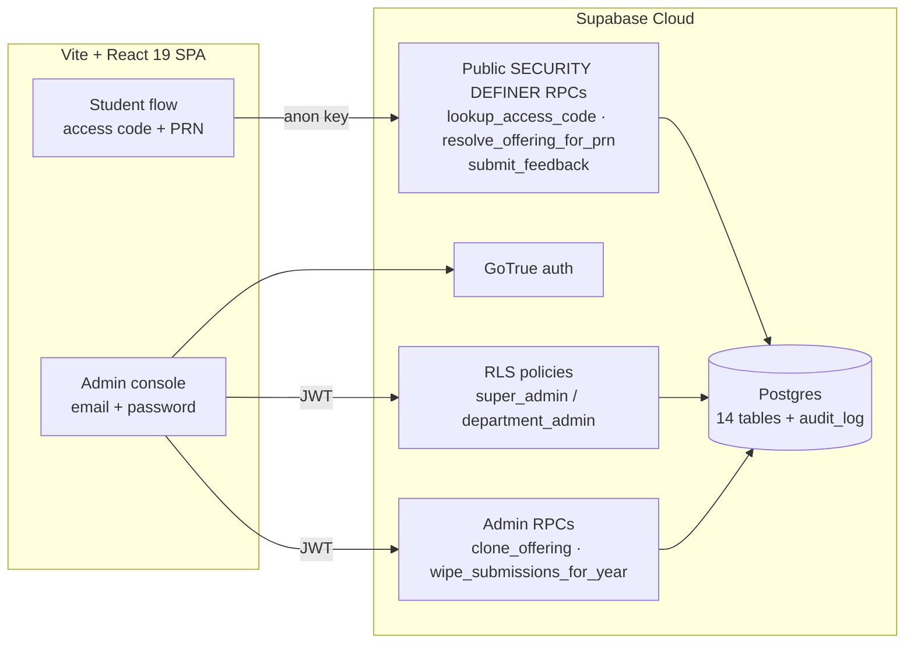

# College Feedback System

**Role-isolated student feedback collection on Supabase: Postgres schema, row-level security, RPCs and pgTAP tests.**


-336791)

[](LICENSE)

Multi-branch student feedback collection for **CSMSS Chh. Shahu College of Engineering, Aurangabad**. Four feedback forms (Ambience, Curriculum, Faculty Performance, Library) collected per (branch × year × division × semester), with strict role isolation between super admin and department admins.

**Status:** Phase 1 (Foundation) — schema, RLS, RPCs, and a smoke UI proving Supabase Cloud connectivity. Phases 2 (Admin Console), 3 (Mobile student flow + Reports), and 4 (Polish + Deploy) follow.

See [`docs/superpowers/PROJECT_PLAN.md`](docs/superpowers/PROJECT_PLAN.md) for the full plan index.

## Highlights

- **Data model in plain SQL** — 14 tables (departments, academic years, divisions, subjects, teachers, offerings, campaigns, access codes, class rosters, submissions, …) in seven ordered migrations.
- **Row-level security for role isolation** — helper functions (`is_super_admin()`, `is_dept_admin_for(dept)`) back policies so a department admin only ever sees their own department.
- **No student accounts** — students authenticate with a shared class access code plus their PRN, validated against an admin-uploaded roster.
- **Anonymity with de-duplication** — anonymous forms store a salted hash of `(PRN, campaign, offering subject)` instead of the PRN itself, so one student cannot submit twice but cannot be identified.
- **Audit trail** — trigger-based `audit_log` on admin-managed tables.
- **Tested at the database layer** — six pgTAP files (44 assertions) run inside `BEGIN … ROLLBACK`.

## Architecture



Students never read tables directly: the anon role can only call the public RPCs, which validate the access code and roster before inserting a submission. Admins read and write through RLS-filtered table access.

---

## Prerequisites

- **Node.js ≥ 20** (`node -v`)
- **psql** (Postgres 15+ client)
- **A Supabase Cloud project** at https://supabase.com (free tier is enough)
- The `pgtap` extension enabled on the project: Dashboard → Database → Extensions → search "pgtap" → toggle on

Docker is **not** required — everything runs against Supabase Cloud directly.

## Quickstart

```bash
git clone -b phase1-foundation https://github.com/rupeshbharambe24/CollegeFeedbackSystem.git
cd CollegeFeedbackSystem
npm install

# 1. Copy env template and fill in real values from your Supabase project
#    (Settings → API for URL/anon key; Settings → Database → Shared Pooler for DB_URL)
cp .env.example .env.local
# edit .env.local

# 2. Apply migrations (in order) and run pgTAP tests
DB_URL="$(grep '^DB_URL=' .env.local | cut -d= -f2-)"
for f in supabase/migrations/*.sql; do psql "$DB_URL" -v ON_ERROR_STOP=1 -f "$f"; done
for f in supabase/tests/*.sql;      do echo "=== $f ==="; psql "$DB_URL" -f "$f"; done

# 3. Create the super admin auth user via the Supabase Dashboard, then:
#    edit supabase/seed/seed_super_admin.sql and replace the placeholder email
psql "$DB_URL" -f supabase/seed/seed_super_admin.sql

# 4. Run the dev server
npm run dev
# → open http://localhost:5173 — you should see the four form templates listed
```

## Project layout

```
.
├── docs/                                 Spec, plans, and form content
│   ├── forms-source-content.md           Text reconstruction of the original paper forms
│   └── superpowers/
│       ├── PROJECT_PLAN.md               Index of spec + four phase plans
│       ├── specs/
│       └── plans/
├── src/
│   ├── App.tsx                           Phase 1 smoke screen (Phase 2/3 will replace)
│   ├── main.tsx
│   ├── styles.css                        Design-token CSS variables
│   ├── data.ts                           Shared TS entity types
│   └── lib/
│       ├── supabase.ts                   Supabase JS singleton
│       ├── auth.ts                       signIn / signOut / getCurrentProfile
│       └── storage.ts                    Typed `list.*` reads + RPC wrappers
└── supabase/
    ├── migrations/                       0001 – 0007 SQL migrations (apply in order)
    ├── tests/                            01 – 06 pgTAP tests (BEGIN/ROLLBACK)
    └── seed/seed_super_admin.sql
```

## Common commands

| Command | What |
|---|---|
| `npm run dev`   | Vite dev server at `http://localhost:5173` |
| `npm run build` | Type-check + production bundle |
| `npm run lint`  | ESLint |
| `psql "$DB_URL" -f supabase/migrations/<file>.sql` | Apply one migration |
| `psql "$DB_URL" -f supabase/tests/<file>.sql`      | Run one pgTAP test (transactional, no side effects) |

## Phase 1 verification checklist

After completing the quickstart, all of these should be true:

- [ ] `npm run build` succeeds.
- [ ] `npm run dev` shows "Form templates seeded (4)" in the browser.
- [ ] All six pgTAP test files report green (44 assertions total).
- [ ] One row in `user_profiles` with `role = 'super_admin'`.
- [ ] `.env.local` exists and is gitignored; `.env.example` does NOT contain real secrets.

## Security notes

- **`.env.local` is gitignored.** Never commit Supabase URL + anon key + DB_URL together; the anon key alone is fine on the frontend, but the DB password is sensitive.
- **`app_dedup_salt()`** is a SECURITY DEFINER function with the salt hardcoded for dev. Rotate before production by editing migration `0005_rpc_public.sql` and re-applying — note that rotating invalidates duplicate detection for past anonymous submissions.
- The `postgres` role on Supabase Cloud cannot `ALTER DATABASE postgres SET app.dedup_salt = ...`, which is why we use a function instead of a GUC.

## Roadmap

| Phase | Scope | State |
|---|---|---|
| 1 — Foundation | Schema, RLS, RPCs, pgTAP tests, smoke UI | Done (this branch) |
| 2 — Admin console | Login + department/offering/campaign management screens | Planned ([outline](docs/superpowers/plans/2026-04-28-college-feedback-phase2-admin-console.md)) |
| 3 — Student flow + reports | Mobile-first form filling, four report outputs | Planned ([outline](docs/superpowers/plans/2026-04-28-college-feedback-phase3-student-flow-and-reports.md)) |
| 4 — Polish + deploy | Notifications, accessibility, deployment | Planned ([outline](docs/superpowers/plans/2026-04-28-college-feedback-phase4-polish-and-deploy.md)) |

## License

Code is released under the [MIT License](LICENSE). The feedback-form questions in `docs/forms-source-content.md` and migration `0007` are reproduced from CSMSS Chh. Shahu College of Engineering's forms.
